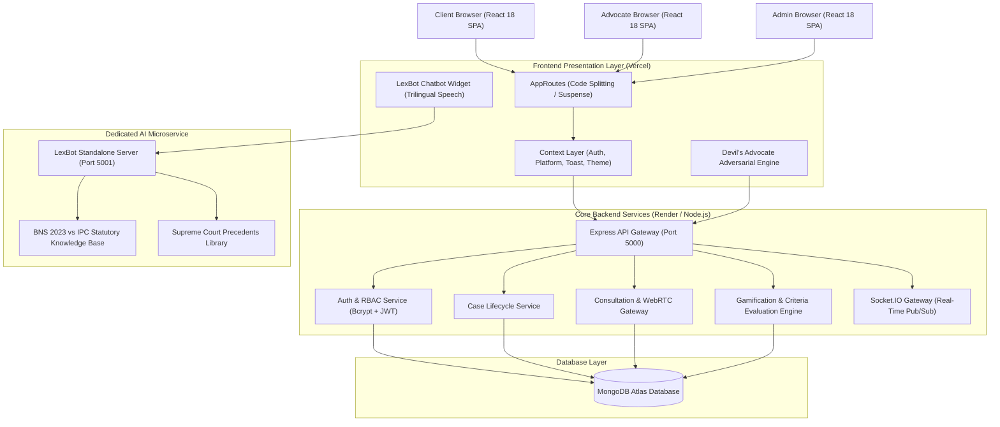
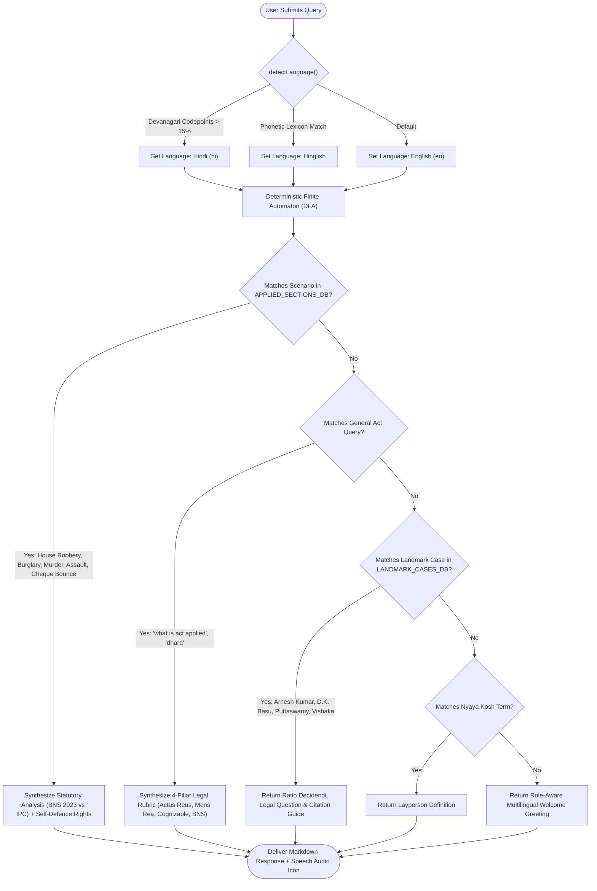
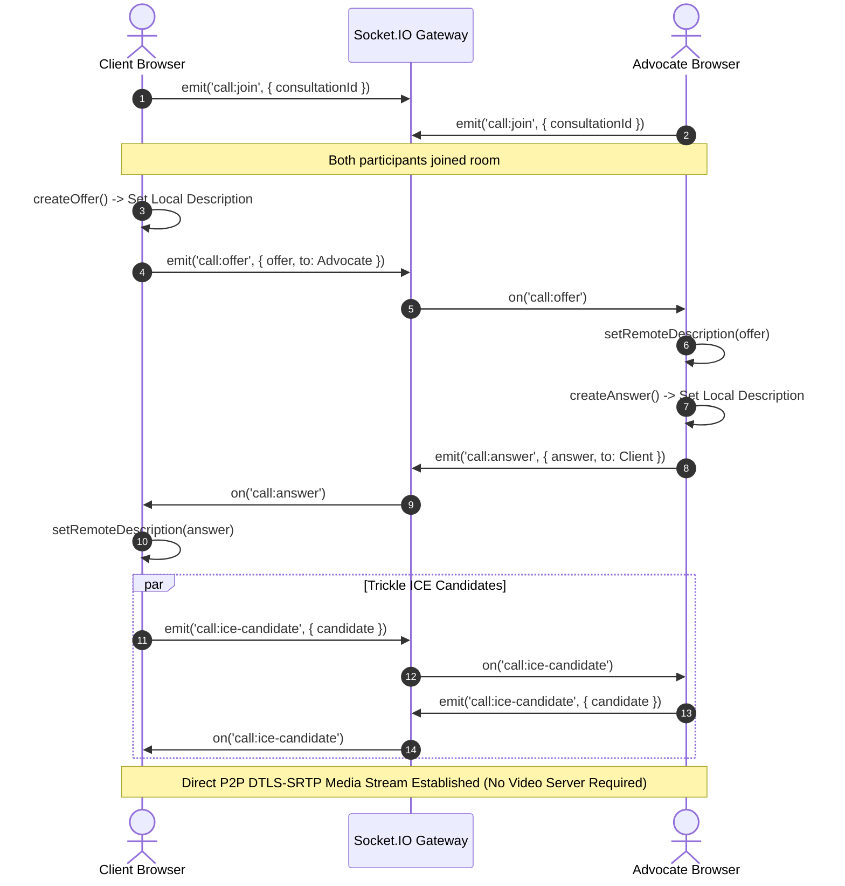

# 📊 Capstone Project Technical Reference: Algorithms, Computational Models & System Architecture

This comprehensive guide details all algorithms, mathematical formulations, data structures, and computational workflows implemented across **LegalConnect** and **LexBot**. You can directly cite these models, complexity analyses, and diagrams in your **Capstone Project Report, Thesis, Presentation, and Viva Voce Defense**.

---

## 📑 Table of Contents
1. [Core Algorithms Summary Table](#1-core-algorithms-summary-table)
2. [Detailed Algorithmic Analysis](#2-detailed-algorithmic-analysis)
   - [Algorithm 1: NLP Intent Classification & Trilingual Vernacular Detection (LexBot)](#algorithm-1-nlp-intent-classification--trilingual-vernacular-detection-lexbot)
   - [Algorithm 2: Adversarial Heuristic Scoring & Vulnerability Detection (Devil's Advocate)](#algorithm-2-adversarial-heuristic-scoring--vulnerability-detection-devils-advocate)
   - [Algorithm 3: Automated Gamification & Metric Progression Engine](#algorithm-3-automated-gamification--metric-progression-engine)
   - [Algorithm 4: Cryptographic Key Derivation & Stateless Token Revocation](#algorithm-4-cryptographic-key-derivation--stateless-token-revocation)
   - [Algorithm 5: WebRTC P2P Signaling & Interactive Connectivity Establishment (ICE)](#algorithm-5-webrtc-p2p-signaling--interactive-connectivity-establishment-ice)
   - [Algorithm 6: In-Memory Fixed-Window Rate Limiting](#algorithm-6-in-memory-fixed-window-rate-limiting)
   - [Algorithm 7: Trailing-Edge Debounced Multi-Criteria Search & Compound Sorting](#algorithm-7-trailing-edge-debounced-multi-criteria-search--compound-sorting)
   - [Algorithm 8: Hardware-Accelerated 0-Render Animation & Memoized Reconciliation](#algorithm-8-hardware-accelerated-0-render-animation--memoized-reconciliation)
3. [System Architecture & Visual Diagrams (Mermaid)](#3-system-architecture--visual-diagrams-mermaid)
4. [Master Viva Voce & Thesis Generation Prompt](#4-master-viva-voce--thesis-generation-prompt)

---

## 1. Core Algorithms Summary Table

| # | Algorithm / Technique | Primary Purpose | File Location & Function | Time Complexity | Space Complexity |
|---|---|---|---|---|---|
| **1** | **Trilingual Vernacular Language Classifier** | Detects English vs Devanagari Hindi vs Hinglish | `chatbotEngine.js` → `detectLanguage()` | $\mathcal{O}(L)$ | $\mathcal{O}(1)$ |
| **2** | **Deterministic Finite Automaton (DFA) Intent Parser** | Maps legal queries to BNS 2023 statutes, cases, or procedures | `chatbotEngine.js` → `generateChatResponse()` | $\mathcal{O}(N \times L)$ | $\mathcal{O}(1)$ |
| **3** | **Adversarial Resilience Scoring Heuristic** | Evaluates legal notice strength and vulnerability against counter-claims | `DevilsAdvocatePanel.jsx` → `baseScore & currentScore` | $\mathcal{O}(K)$ | $\mathcal{O}(1)$ |
| **4** | **Limitation Period & Procedural Deadline Calculation** | Computes statutory limitation windows (e.g., 30d/15d for NI Act Sec 138) | `LegalNoticeGenerator.jsx` → `calculateDates()` | $\mathcal{O}(1)$ | $\mathcal{O}(1)$ |
| **5** | **Gamification Progression & Criteria Evaluation** | Computes advocate performance metrics and awards credentials | `badge.service.js` → `checkAndAwardBadges()` | $\mathcal{O}(B + C + R)$ | $\mathcal{O}(B)$ |
| **6** | **Bcrypt Adaptive Key Derivation (Work Factor $2^{12}$)** | Secure password hashing resistant to GPU/ASIC brute-force | `auth.controller.js` & `User.js` (`bcrypt.hash`) | $\mathcal{O}(2^{12})$ | $\mathcal{O}(1)$ |
| **7** | **HMAC-SHA256 Token Signing & Epoch Revocation** | Stateless session management with instantaneous invalidation | `jwt.js` & `auth.middleware.js` | $\mathcal{O}(M)$ | $\mathcal{O}(1)$ |
| **8** | **WebRTC P2P ICE Negotiation State Machine** | Peer-to-peer browser video/audio connection without media servers | `useVideoCall.js` & `socket/index.js` | $\mathcal{O}(1)$ per signal | $\mathcal{O}(1)$ |
| **9** | **In-Memory Fixed-Window Rate Limiting** | Mitigates DoS and API abuse on chatbot and auth endpoints | `server.js` → `rateLimiter()` | $\mathcal{O}(1)$ | $\mathcal{O}(U)$ |
| **10** | **Trailing-Edge Debounced Search** | Eliminates network flooding during typing in advocate directory | `FindAdvocates.jsx` → `useEffect(debounce)` | $\mathcal{O}(1)$ cancel | $\mathcal{O}(1)$ |

*(Where $L$ = query length, $N$ = pattern database size, $K$ = field count, $B$ = badge count, $C$ = consultations, $R$ = reviews, $U$ = unique active IPs).*

---

## 2. Detailed Algorithmic Analysis

### Algorithm 1: NLP Intent Classification & Trilingual Vernacular Detection (LexBot)
- **Module:** LexBot Legal Assistant Microservice
- **Files:** [`legalconnect/frontend/src/services/chatbotEngine.js`](file:///c:/CapstoneProject/legalconnect/frontend/src/services/chatbotEngine.js) & [`legalconnect-chatbot/services/chatbot.service.js`](file:///c:/CapstoneProject/legalconnect-chatbot/services/chatbot.service.js)
- **Functions:** `detectLanguage(text, preferredLang)`, `generateChatResponse(message, role, name, lang)`

#### Mathematical & Algorithmic Formulation:
1. **Vernacular Script Classification:**
   The algorithm inspects the Unicode codepoint distribution of the user query $Q$:
   $$\text{Devanagari Ratio } R_{dev} = \frac{\sum_{i=1}^{|Q|} \mathbb{I}(c_i \in [\text{U+0900}, \text{U+097F}])}{|Q|}$$
   If $R_{dev} > 0.15 \implies \text{Language} = \text{"hi"}$ (Devanagari Hindi).
   Otherwise, the query is scanned against a Hinglish phonetic token set $\mathcal{H} = \{\text{"kya"}, \text{"kaise"}, \text{"dhara"}, \text{"kanoon"}, \text{"chori"}, \text{"advocate"}, \dots\}$:
   $$\text{Hinglish Count } C_{hing} = \sum_{w \in \text{Tokens}(Q)} \mathbb{I}(w \in \mathcal{H})$$
   If $C_{hing} \ge 1 \implies \text{Language} = \text{"hinglish"}$, else default to $\text{"en"}$.

2. **Hierarchical Deterministic Finite Automaton (DFA) Intent Matching:**
   Queries pass through an ordered priority filter:
   - **Stage 1 (Applied Jurisprudence):** Evaluates regex boundary patterns $\mathcal{P}_{scenario}$ across criminal/civil matrices (e.g. house robbery under BNS 309(4), night burglary under BNS 331(6), self-defence under BNS 41, murder under BNS 103, cheque bounce under NI Act 138).
   - **Stage 2 (Statutory Invariant Match):** Fallback heuristic for broad legal queries (*"what is act applied"*, *"konsi dhara"*).
   - **Stage 3 (Constitutional Precedents):** Scans for Supreme Court case tokens (*"Arnesh Kumar"*, *"D.K. Basu"*, *"Puttaswamy"*).
   - **Stage 4 (Nyaya Kosh):** Scans against legal dictionary definitions.
   - **Stage 5 (Navigation & Role Routing):** Routes to platform pages (advocates, consultations, cases).

---

### Algorithm 2: Adversarial Heuristic Scoring & Vulnerability Detection (Devil's Advocate)
- **Module:** AI Legal Notice Generator & Devil's Advocate Engine
- **Files:** [`legalconnect/frontend/src/components/DevilsAdvocatePanel.jsx`](file:///c:/CapstoneProject/legalconnect/frontend/src/components/DevilsAdvocatePanel.jsx) & [`legalconnect/frontend/src/pages/client/LegalNoticeGenerator.jsx`](file:///c:/CapstoneProject/legalconnect/frontend/src/pages/client/LegalNoticeGenerator.jsx)

#### Mathematical & Algorithmic Formulation:
The resilience score $S_{resilience}$ models the notice's survivability in court against counter-claims:
$$S_{base} = S_0 + \sum_{i=1}^{m} w_i \cdot \phi_i(\mathbf{x})$$
Where:
- $S_0 = 70$ (baseline score for a completed formal template).
- $\phi_i(\mathbf{x}) \in \{0, 1\}$ are indicator functions for evidentiary proofs (e.g. verified sender/recipient identities, explicit liquidated sum, Bar Council registered advocate credentials).
- $w_i \in [4, 6]$ are specific statutory evidentiary weights (e.g., $+6$ if Cheque Return Memo date is provided for NI Act notice).
- $\Delta_{chat} \in [-30, +30]$ dynamically shifts the score based on adversarial cross-examination responses during simulation:
$$S_{final} = \min(\max(S_{base} + \Delta_{chat}, 30), 98)$$

#### Limitation Period Invariant Engine:
For Section 138 Negotiable Instruments Act:
$$\text{Notice Deadline} = T_{memo} + 30 \text{ days}$$
$$\text{Statutory Cure Period} = T_{receipt} + 15 \text{ days}$$
$$\text{Cause of Action Accrual} = T_{receipt} + 16 \text{ days}$$
$$\text{Criminal Complaint Deadline} = (\text{Cause of Action}) + 30 \text{ days}$$
If $T_{dispatch} > T_{memo} + 30$, the algorithm flags a **Fatal Procedural Bar** to criminal prosecution under Section 142(1)(b) NI Act.

---

### Algorithm 3: Automated Gamification & Metric Progression Engine
- **Module:** Advocate Verification & Performance Analytics
- **File:** [`legalconnect/backend/src/services/badge.service.js`](file:///c:/CapstoneProject/legalconnect/backend/src/services/badge.service.js)
- **Functions:** `getAdvocateStats()`, `checkAndAwardBadges()`

#### Algorithmic Logic:
1. **Metric Aggregation:**
   - Consultation Completion Rate:
     $$\text{CR} = \left(\frac{N_{\text{completed}}}{N_{\text{completed}} + N_{\text{confirmed}} + N_{\text{no\_show}}}\right) \times 100$$
   - Arithmetic Mean Rating:
     $$\bar{R} = \frac{1}{|V|} \sum_{v \in V} R_v$$
2. **Criteria Evaluation:**
   For each badge $b \in \mathcal{B}$, evaluate predicate $P(b)$:
   $$P(b) = \begin{cases}
     M(b) \ge \tau_b & \text{if operator} = \text{'gte'} \\
     M(b) \le \tau_b & \text{if operator} = \text{'lte'} \\
     M(b) = \tau_b & \text{if operator} = \text{'eq'}
   \end{cases}$$
   If $P(b) \land b \notin \mathcal{B}_{earned}$, award badge, persist `UserBadge`, and push real-time notification via WebSocket.

---

### Algorithm 4: Cryptographic Key Derivation & Stateless Token Revocation
- **Module:** Security & Authentication Engine
- **Files:** [`legalconnect/backend/src/models/User.js`](file:///c:/CapstoneProject/legalconnect/backend/src/models/User.js) & [`legalconnect/backend/src/middleware/auth.js`](file:///c:/CapstoneProject/legalconnect/backend/src/middleware/auth.js)

#### Mathematical & Security Specifications:
1. **Password Key Derivation (Bcrypt):**
   Uses the Blowfish-based key derivation algorithm with Work Factor (Cost Parameter) $C = 12$:
   $$2^{12} = 4,096 \text{ iterations of modified Eksblowfish key schedule}$$
   This introduces deliberate computational cost ($>250\text{ms}$ per hash), neutralizing rainbow table and high-speed GPU hash-cracking attacks.

2. **Stateless Epoch Token Revocation (`tokenVersion`):**
   Standard JWTs cannot be revoked without stateful token blacklists (which degrade performance). LegalConnect implements an **Epoch Counter Invalidation Scheme**:
   - The user record stores an integer `tokenVersion` (initial value: 0).
   - The signed JWT payload contains $\{ \text{userId}, \text{role}, \text{tokenVersion} \}$.
   - Upon password change, logout-all, or account suspension:
     $$\text{tokenVersion} \leftarrow \text{tokenVersion} + 1$$
   - Middleware compares $\text{payload.tokenVersion} \stackrel{?}{=} \text{user.tokenVersion}$. Older tokens become invalid in $\mathcal{O}(1)$ without maintaining expensive Redis blacklist databases.

---

### Algorithm 5: WebRTC P2P Signaling & Interactive Connectivity Establishment (ICE)
- **Module:** 1-to-1 Video Consultation
- **Files:** [`legalconnect/frontend/src/hooks/useVideoCall.js`](file:///c:/CapstoneProject/legalconnect/frontend/src/hooks/useVideoCall.js) & [`legalconnect/backend/src/socket/index.js`](file:///c:/CapstoneProject/legalconnect/backend/src/socket/index.js)

#### Finite State Machine (FSM):
1. **State 1 (Initiation):** Client/Advocate joins consultation room: `socket.emit('call:join', { consultationId })`.
2. **State 2 (Offer Creation):** Caller initiates peer connection, creates SDP offer:
   $$\text{SDP}_{offer} = \text{RTCPeerConnection.createOffer()}$$
   State transitions to `have-local-offer`.
3. **State 3 (Signaling Relay):** Offer relayed via Socket.IO room to callee.
4. **State 4 (Answer Generation):** Callee sets remote description, generates SDP answer:
   $$\text{SDP}_{answer} = \text{RTCPeerConnection.createAnswer()}$$
5. **State 5 (Trickle ICE Candidates):** Both peers asynchronously gather STUN candidates (NAT traversal) and stream them over WebSocket (`call:ice-candidate`).
6. **State 6 (P2P Media Channel):** Direct encrypted DTLS-SRTP audio/video stream established peer-to-peer.

---

### Algorithm 6: In-Memory Fixed-Window Rate Limiting
- **Module:** Standalone LexBot Server Security
- **File:** [`legalconnect-chatbot/server.js`](file:///c:/CapstoneProject/legalconnect-chatbot/server.js)

#### Algorithm Steps:
Let $W = 60,000 \text{ ms}$ (1 minute window) and $M = 60 \text{ requests}$.
For each incoming request from client IP:
1. Lookup $\text{Record} = \text{Map.get}(IP)$.
2. If $T_{now} > \text{Record.resetTime}$:
   $$\text{Record.count} \leftarrow 1, \quad \text{Record.resetTime} \leftarrow T_{now} + W$$
3. Else:
   $$\text{Record.count} \leftarrow \text{Record.count} + 1$$
4. If $\text{Record.count} > M \implies \text{Reject with HTTP 429 Too Many Requests}$.
5. Background GC interval cleans expired records every $W$ seconds to maintain $\mathcal{O}(U)$ memory bounded by active users.

---

### Algorithm 7: Trailing-Edge Debounced Multi-Criteria Search & Compound Sorting
- **Module:** Advocate Discovery
- **File:** [`legalconnect/frontend/src/pages/client/FindAdvocates.jsx`](file:///c:/CapstoneProject/legalconnect/frontend/src/pages/client/FindAdvocates.jsx)

#### Debounce Trailing-Edge Invariant:
Let $K(t)$ be the keystroke event at time $t$, and delay $\delta = 250 \text{ ms}$.
$$\text{Execute Search}(Q) \iff \nexists \, K(t') \text{ where } t < t' < t + \delta$$
Cancels redundant intermediate network transmissions when the user types rapidly (e.g. typing "criminal lawyer" emits 1 HTTP call instead of 15).

#### Compound Multi-Attribute Search Scoring:
In MongoDB, queries use indexed compound sorting:
$$\text{Sort Clause} = \begin{cases}
  \{ \text{avgRating}: -1, \text{reviewCount}: -1 \} & \text{if sort} = \text{'rating'} \\
  \{ \text{experienceYears}: -1 \} & \text{if sort} = \text{'experience'} \\
  \{ \text{hourlyRate}: 1 \} & \text{if sort} = \text{'fee\_asc'} \\
  \{ \text{hourlyRate}: -1 \} & \text{if sort} = \text{'fee\_desc'}
\end{cases}$$

---

### Algorithm 8: Hardware-Accelerated 0-Render Animation & Memoized Reconciliation
- **Module:** UI Architecture & Performance Optimization
- **Files:** [`ToastContext.jsx`](file:///c:/CapstoneProject/legalconnect/frontend/src/context/ToastContext.jsx), [`PlatformContext.jsx`](file:///c:/CapstoneProject/legalconnect/frontend/src/context/PlatformContext.jsx), [`useSocket.js`](file:///c:/CapstoneProject/legalconnect/frontend/src/hooks/useSocket.js)

1. **Replaced 60fps React State Loop with CSS Keyframe Animation:**
   - Previous: `requestAnimationFrame` called `setProgress(pct)` on every frame $\implies 60\text{--}120\text{ re-renders/sec}$ per active toast.
   - Optimized: Single native keyframe transition executed on GPU thread via compositor:
     $$\text{Width}(t) = 100\% \times \left(1 - \frac{t}{\text{duration}}\right)$$
   - Total React re-renders during active toast: **Zero**.
2. **WebSocket Singleton Connection Pooling:**
   - Uses reference counting ($\text{refCount}$) to maintain exactly **one** shared socket instance across all components, avoiding duplicate TCP/WS handshakes.

---

## 3. System Architecture & Visual Diagrams (Mermaid)

### Diagram A: High-Level System Architecture & Microservice Topology


---

### Diagram B: LexBot Natural Language Processing (NLP) Intent Resolution Pipeline


---

### Diagram C: WebRTC 1-to-1 Video Consultation Signaling State Machine


---

## 4. Master Viva Voce & Thesis Generation Prompt

If you need to generate specific sections for your final Capstone Project Report (such as *Chapter 3: Methodology*, *Chapter 4: Implementation*, or *Project Viva Voce Q&A*), copy and paste the prompt below into an LLM:

```text
PROMPT FOR CAPSTONE REPORT GENERATION:
--------------------------------------------------------------------------------
I am submitting my final B.Tech / MCA Capstone Project titled:
"LegalConnect: A Unified Legal-Tech Platform with AI Jurisprudence Engine & Automated Notice Verification"

Here are the verified technical and algorithmic specifications of the project:
1. Technologies: React 18, Vite, Tailwind CSS, Node.js, Express, MongoDB Atlas, Socket.IO, WebRTC peer-to-peer.
2. Architecture: Microservices topology featuring a core API server (port 5000) and a standalone LexBot statutory engine (port 5001).
3. Primary Algorithms:
   - Trilingual Vernacular Language Detection (Devanagari codepoint ratio + phonetic lexicon scoring).
   - Deterministic Finite Automaton (DFA) Statutory Intent Resolution compliant with Bharatiya Nyaya Sanhita (BNS 2023) vs IPC 1860.
   - Adversarial Legal Resilience Scoring Heuristic (Devil's Advocate Engine) scoring evidentiary proof and procedural limitation periods (e.g. NI Act Sec 138 30-day notice window).
   - Gamification & Performance Metric Progression Engine for advocate verification badges.
   - Stateless Token Revocation using epoch counter versioning (tokenVersion) without stateful token blacklists.
   - WebRTC Interactive Connectivity Establishment (ICE) and SDP negotiation state machine for 1-to-1 video calls.
   - Fixed-window rate limiting algorithm (in-memory Map with O(1) IP tracking and background garbage collection).
   - Trailing-edge debouncing algorithm for advocate search to eliminate network thrashing.
   - GPU-accelerated CSS keyframe animations replacing 60 FPS requestAnimationFrame polling in the notification toast system.

TASK:
Generate a formal, publication-ready academic section for my project report titled:
"CHAPTER 3: ALGORITHMIC METHODOLOGY AND COMPUTATIONAL ARCHITECTURE"
Include:
- Mathematical formulations and objective functions for each algorithm.
- Algorithmic pseudocode in LaTeX/ACM format.
- Time and Space complexity analyses (Big-O).
- Justification of architectural choices (e.g., why standalone microservice for LexBot, why WebRTC peer-to-peer over MCU media servers).
- A 10-question Viva Voce Defense guide with technical answers demonstrating deep mastery of the codebase.
--------------------------------------------------------------------------------
```
